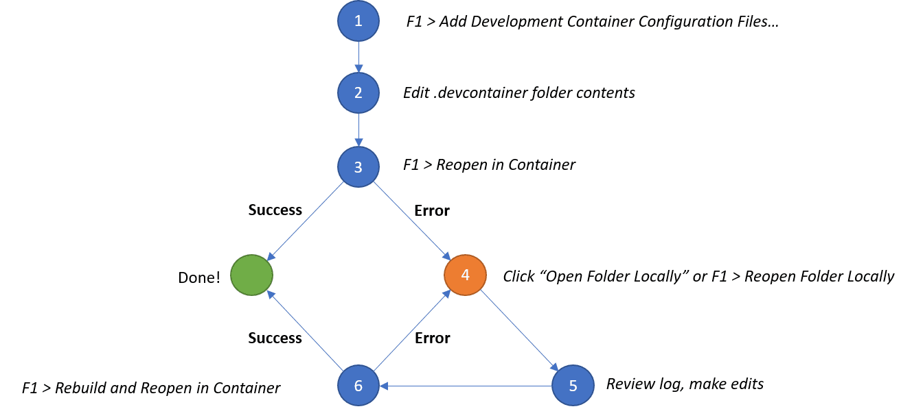

```
volumes:
  ...
```

note:

- **twee onderdelen** met dezelfde naam, **op andere plaats in docker-compose.yml**
- `volumes` op hetzelfde niveau als `services` geeft aan welke volumes bestaan
- `volumes` onder een services geeft aan welke bind mounts en volumes aangesloten zijn op een container in de Compose stack

---

```
networks:
  ...
```

note:

- zelfde opmerking rond twee voorkomens
- op niveau van `services` betekent het: "deze netwerken bestaan"
- onder een service betekent het: "deze service is aangesloten op dit netwerk"

---

```
environment:
  MYSQL_ROOT_PASSWORD: nietzoheelgeheim
```

note:

- slecht idee (secrets staan gewoon in versiebeheer, raken makkelijk verspreid en zijn ook niet geëncrypteerd, niet zo evident hoe de applicatie te parametriseren,...)

---

`.env` file

note:

- beter, kan in .gitignore, is ook een centrale plaats voor alle configuratie

---

```
services:
  myapp:
    image: httpd
    secrets:
      - my_secret
secrets:
  my_secret:
    file: ./my_secret.txt
```

note:

- in de container: `/run/secrets/my_secret` met als inhoud dezelfde als `my_secret.txt`
- fijnkorrelig (expliciete toegang per individuele secret)
- kan niet per ongeluk in logging,... opduiken, applicatie moet heel doelbewust op die plaats in filesysteem gaan kijken
- veronderstelt dan ook wel dat de applicatie deze "good practice" volgt!
  - zie bv. MySQL documentatie op Docker Hub

---

## meerdere commando's als `CMD`

```
bash -c "commando1 && commando2 && commando3 &&..."
```

note:

- technisch gesproken is dit één commando (`bash`)
- de bedoelde commando's zijn één stringargument
  - vergelijk met bv. JavaScript `eval`

---

## Dev containers

note:

- "normale" containers voorzien een standaard voor **deployment**
- development gebeurt normaal met aparte tools, vaak afgesproken binnen een team
- idee oplossing: een image met development tools (SDK, debugger,...)
- praktisch obstakel: **werken** op de container

---

## Aanpak 1

note:

- gewoon development libraries en een terminal text editor installeren **op** een container
- voordeel: heel simpel
- nadeel: niet altijd handig, zeker niet als je geen terminal text editor gebruikt of de jouwe zwaar customizet

---

## Multi-stage build

```dockerfile
# syntax=docker/dockerfile:1
FROM golang:1.26 AS build
WORKDIR /src
COPY <<EOF /src/main.go
package main

import "fmt"

func main() {
  fmt.Println("hello, world")
}
EOF
RUN go build -o /bin/hello ./main.go

FROM scratch
COPY --from=build /bin/hello /bin/hello
CMD ["/bin/hello"]
```

note:

- voorbeeldje gelift uit Docker documentatie
- tools om een applicatie te bouwen (dev container) ‡ tools om applicatie te runnen (gewone container), maar er is overlap
  - in de eerste situatie vaak veel meer nodig: build tool, testing framework,... (je kent vast `npm i --dev`)
- kan op deze manier eerste stage gebruiken om bv. executable te produceren en dan enkel de executable en runtime dependencies kopiëren naar tweede image

---

## Aanpak 2

note:

- VSC remote development containers extensie (sommige andere editors delen dit systeem wel, bv. IntelliJ)
- nadeel: vereist server op container (eet wel wat resources)
- nadeel: extra laag complexiteit (configuratie in JSON bovenop bestaande Dockerfile en Docker Compose file, al dan niet zichtbaar)
  - soms meerdere manieren om hetzelfde te doen
- voordeel: heel gebruiksvriendelijk, met onmiddellijke configuratie van de editor (plugins,...)
- demo met file in bijlage
  - zal pak langer duren eerste keer, zelfde werking met caching,...
  - merk op: normale user ingesteld (developen doen we normaal niet als root...)
  - merk op: projectstructuur gemount onder `/workspaces/NAAMVANPROJECT`
  - merk op: tools ter beschikking die niet noodzakelijk op de hostmachine staan (bv. `tsc` voor voorbeeld in bijlage)
  - merk op: aangepaste CLI prompt, Git geïnstalleerd in de container
- referentie: https://code.visualstudio.com/docs/devcontainers/create-dev-container
- tweede goede referentie: containers.dev
- kan je zelf ook bouwen, is gewoon een Docker image met wat voorgeconfigureerde settings (zoals die user,...)
  - zie bv. https://github.com/devcontainers/images/tree/main

---

## Overlap

note:

- `"build": { "dockerfile": "Dockerfile" }` betekent dat we Dockerfile kunnen aanpassen om extra software,... te installeren
- `features` zal typisch ook dingen installeren en configureren...
  - vermijdt dat je steeds zelfde stappen in Dockerfile moet zetten
- `forwardPorts` (in JSON) vs. `ports` (in docker-compose.yml)
  - forwarding via VSC server versus via host
  - er is een technisch verschil:
    - applicatie die bv. enkel connecties vanaf localhost aanvaardt, zal met systeem van Docker inkomende connecties weigeren
    - port forwarding van devcontainers zorgen dat inkomende connectie echt van localhost lijkt te komen
- `postStartCommand` of `postCreateCommand` om NPM packages te installeren
  - tegenover `RUN npm i`, niet identiek maar liggen dicht bij elkaar

---

## Met Docker Compose

```
{
    "dockerComposeFile": "docker-compose.yml",
    "service": "devcontainer",
    "workspaceFolder": "/workspaces/${localWorkspaceFolderBasename}"
}
```

note:

- eerste: evident
- tweede: "welke container uit de stack is de 'hoofdcontainer'", i.e. waar opent onze terminal,...?
- derde: zegt waar in het filesysteem van de container ons VSC-project zichtbaar wordt, zoals een bind mount dus

---


