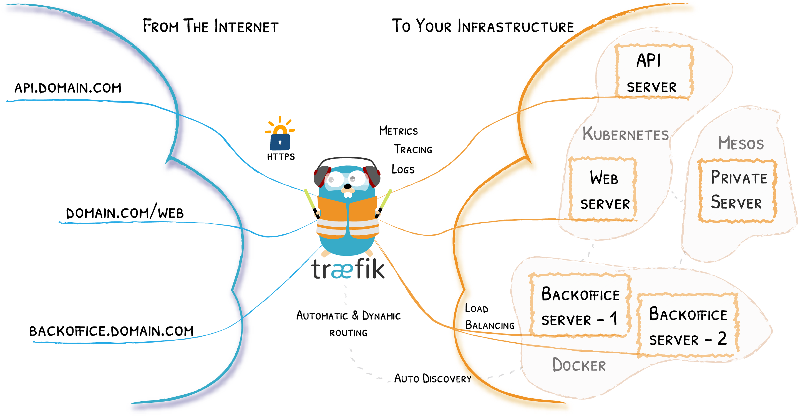
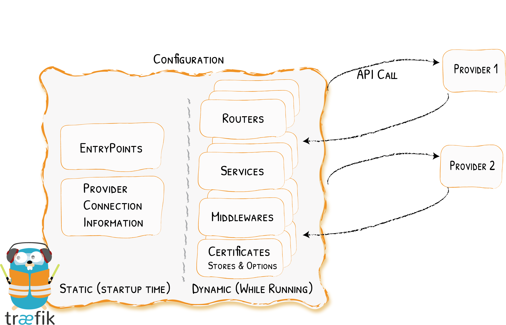
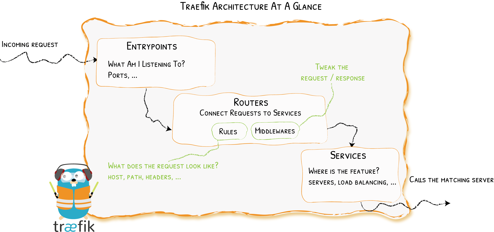

# Traefik

<aside class="notes"><ul>
<li>reverse proxy<ul>
<li>kan dus kenmerken van inkomend verkeer bekijken (hostnaam,... zelfs als IP gelijk is)</li>
<li>kan deze gebruiken om de juiste achterliggende service aan te spreken</li>
<li>verschillende voordelen<ul>
<li>extra tussenstop is handig voor monitoren / beveiligen / ... diensten</li>
<li>load balancing</li>
<li>zero-downtime redeployment</li>
<li>mogelijk meerdere applicaties op dezelfde server te runnen zonder dat gebruiker hier iets van merkt (domeinnamen zijn anders)</li>
<li>kan dit via configuratiefile <strong>of</strong> door metadata die aan containers wordt gekoppeld ("labels")</li>
</ul>
</li>
</ul>
</li>
<li><strong>erg uitgebreid, we bekijken gewoon basis</strong></li>
</ul>
</aside>

---



---

<ul>
<li>entrypoints</li>
<li>routers</li>
<li>middleware</li>
<li>services</li>
</ul>
<aside class="notes"><ul>
<li>entrypoints geven aan hoe de setup bereikt kan worden (protocol, poort,...)</li>
<li>routers geven aan hoe een inkomend request doorgestuurd kan worden naar een dienst achter de proxy</li>
<li>middleware herschrijft een request (bv.: intern wordt geen HTTPS 
gebruikt en web servers kennen dat meestal ook niet, dus herschrijf naar
 HTTP)</li>
<li>services: wat achter de proxy zit<ul>
<li>Traefik "wrapt" deze, bijvoorbeeld door meerdere instanties met load balancing te behandelen als één service</li>
</ul>
</li>
</ul>
</aside>

---

```yaml
services:
  reverse-proxy:
    image: traefik:v3.2
    # dit voegt extra opties toe aan het defaultcommando
    # in de Dockerfile voor Traefik staat "entrypoint"
    # dat deel is vast
    command: --api.insecure=true --providers.docker
    ports:
      - "80:80"
      - "8080:8080" # web UI, kan door api.insecure=true
    volumes:
      # zo kan Traefik meteen reageren op wijzigingen containers
      - /var/run/docker.sock:/var/run/docker.sock
```


<aside class="notes"><ul>
<li>Traefik kan ook met andere systemen werken, maar hier wordt het nu eenmaal opgestart in Docker (Compose)</li>
<li>Run dit al een keer, toon web UI<ul>
<li>bekijk entrypoints (HTTP entrypoint = TCP op poort 80,...)</li>
<li>tabs bovenaan: HTTP, TCP, UDP geven routers, services en middleware <strong>voor die protocols</strong><ul>
<li>M.O.: HTTP krijgt dus speciale behandeling want is bovenop TCP (en HTTP3 uiteindelijk bovenop UDP)</li>
</ul>
</li>
<li>klik op een router om in detail te bekijken<ul>
<li>rule drukt uit wanneer die router zal doorsturen naar bepaalde service<ul>
<li><code>Host</code> voor wanneer we de reverse proxy bereikt hebben via bepaalde hostnaam</li>
<li><code>PathPrefix</code> voor wanneer onderdeel voorkomt vooraan in pad (na domeinnaam): zie bv. <code>http://localhost:8080/api/entrypoints</code>, is niet op dashboard</li>
</ul>
</li>
</ul>
</li>
</ul>
</li>
</ul>
</aside>

---

```yaml
services:
  reverse-proxy:
    image: traefik:v3.2
    command: --api.insecure=true --providers.docker
    ports:
      - "80:80"
      - "8080:8080" # web UI, kan door api.insecure=true
    volumes:
      - /var/run/docker.sock:/var/run/docker.sock
  whoami:
    image: traefik/whoami
    labels:
      - "traefik.http.routers.whoami.rule=Host(`whoami.localhost`)"
```

<aside class="notes"><ul>
<li>toegelaten subdomeinen voor localhost te voorzien</li>
<li>toon effect van toevoeging: surf naar <code>whoami.localhost</code><ul>
<li>officieel voorbeeld gebruikt <code>.docker.localhost</code> maar redundant en introduceert verwarring over rol</li>
</ul>
</li>
<li>check met <code>docker inspect</code></li>
<li>check ook via web UI<ul>
<li>Docker provider ⇒ metadata van hierboven wordt gebruikt om regel te communiceren naar Traefik</li>
</ul>
</li>
<li>voeg een extra Docker service toe voor een Apache web server, toon 
ook dat naam Docker Compose service ≠ naam router ≠ naam Traefik service
 (of toch niet noodzakelijk)</li>
</ul>
</aside>

---




<aside class="notes"><ul>
<li>wijziging startup/statische informatie vereist restart</li>
<li>wijziging routing/dynamische config kan na deployment gebeuren</li>
</ul>
</aside>

---

<p>Startupconfiguratie</p>
<aside class="notes"><ul>
<li>vroeger ook "statische configuratie"</li>
<li>meerdere opties, maar mutually exclusive<ul>
<li>CLI</li>
<li>YAML file</li>
<li>omgevingsvariabelen</li>
</ul>
</li>
<li>eerdere voorbeelden gebruikten CLI: <code>--providers.docker</code><ul>
<li>veel meer opties: <a href="https://doc.traefik.io/traefik/reference/static-configuration/cli/">https://doc.traefik.io/traefik/reference/static-configuration/cli/</a></li>
<li>entrypoint HTTP is er sowieso, "traefik" komt van insecure API</li>
</ul>
</li>
</ul>
</aside>

---

<p>Routingconfiguratie</p>
<aside class="notes"><ul>
<li>vroeger ook "dynamische configuratie"</li>
<li>veel concepten: bekijk in termen van "hoe komt iets binnen en waar moet het naartoe?"</li>
<li>zullen voorbeelden vaak geven via Docker labels<ul>
<li>vereist toegang tot Docker socket<ul>
<li>dit omvat eigenlijk een security risico (succesvolle aanval op Traefik = op heel de <strong>host</strong>)<ul>
<li>workarounds in Traefik docs, kan ook via dynamische config file werken</li>
<li>nuttig om meerdere syntaxen te kunnen lezen, dan kan je voorbeeldcode omzetten</li>
</ul>
</li>
</ul>
</li>
</ul>
</li>
<li>ga even terug, duid aan van waar de statische configuratie komt en van waar de dynamische<ul>
<li>Compose file zelf is geen Traefik configuratie!</li>
</ul>
</li>
<li>rule priority: langere regel = hogere prioriteit, specifiekere regel krijgt dus voorrang!</li>
</ul>
</aside>

---

<p>Truukje dashboard</p>
<aside class="notes"><ul>
<li>Sommige hostingoplossingen laten alleen poorten 22, 80 en 443 open</li>
<li>Traefik web UI is by default op poort 8080, zie eerdere docker-compose.yaml<ul>
<li>laat voorlopig aan staan</li>
</ul>
</li>
<li>bekijk rules over dit entrypoint in web UI: <code>PathPrefix(\</code>/`)<code>en</code>PathPrefix(`/api`)`</li>
<li>voeg uiteindelijk toe:</li>
</ul>
<pre><code class="">labels:
  - "traefik.http.routers.webui.rule=PathPrefix(`/dashboard`)"
  - "traefik.http.routers.api.rule=PathPrefix(`/api`)"
  - "traefik.http.services.traefik-experiments-reverse-proxy.loadbalancer.server.port=8080"</code></pre></aside>

---



<aside class="notes"><ul>
<li>check zaken in de UI!</li>
</ul>
</aside>

---

```yaml
entryPoints:
  web:
    address: :8081
providers:
  file:
    filename: /path/to/dynamic/conf
```

note:

- dit is startup/statische config
---


```yaml
http:
  routers:
    to-whoami:
      rule: "Host(`example.com`) &amp;&amp; PathPrefix(`/whoami/`)"
      middlewares:
        - test-user # zie onder
      service: whoami
  middlewares:
    test-user:
      basicAuth:
        users:
        # dit is niet het wachtwoord, maar de hash
        # run htpasswd -nb usernaamnaarkeuze wachtwoordnaarkeuze
        - user:hashcode
  services:
    whoami:
      loadBalancer: # één Traefik service, mogelijk meerdere containers
        servers:
        - url: http://private/whoami-service
```

<aside class="notes"><ul>
<li>dynamisch</li>
<li>vergelijk met onderdelen dashboard</li>
<li>htpasswd staat op httpd images</li>
</ul>
</aside>

---

<p>TLS (manueel)</p>
<aside class="notes"><ul>
<li>ingebouwd certificaat</li>
<li>kan eventueel via `cron`,... legitiem certificaat ophalen en updaten</li>
</aside>

---

<p>TLS (automatisch)</p>
<aside class="notes"><ul>
<li><a href="https://doc.traefik.io/traefik/https/acme/">https://doc.traefik.io/traefik/https/acme/</a></li>
<li>eigenlijk maar paar zaken nodig<ul>
<li>certificatesResolvers gedeelte in statische config<ul>
<li>start eerst met de staging server!</li>
</ul>
</li>
<li>optie certresolver in dynamische config</li>
<li>initieel lege acme.json file (moet containers overleven) met permissies 600</li>
</ul>
</li>
<li>waarschuwing rond "onveilige website", maar bekijk de details: <strong>er is een certificaat</strong></li>
</ul>
</aside>

---

[De documentatie](https://doc.traefik.io/traefik/getting-started/configuration-overview/)

<aside class="notes"><ul>
<li>uitstekende kwaliteit (maar: lees traag en aandachtig)</li>
<li>voorbeelden in verschillende formaten, de moeite waard om te weten wat ze zijn zodat je kan vertalen naar jouw setting</li>
<li></li>
</ul>
</aside>

---

<p>Middleware en plugins</p>
<aside class="notes"><ul>
<li>hier kan overlap zijn qua functionaliteit</li>
<li>aantal voorbeelden:<ul>
<li>Middleware: BasicAuth</li>
<li>Middleware: Compression</li>
<li>Middleware: StripPrefix</li>
<li>Plugin: Real IP from Cloudflare</li>
<li>Plugin: Simple cache</li>
<li>Plugin: theme.park om meerdere apps uniform te themen</li>
</ul>
</li>
</ul>
</aside>

