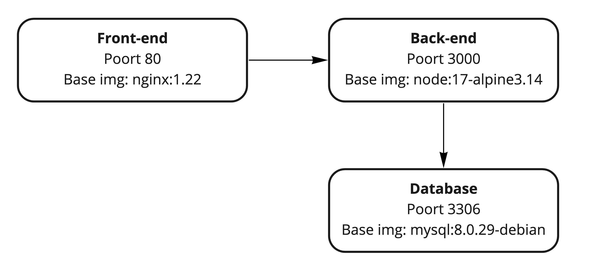

## Situatie

Je werkt voor ACME. Ze hebben onlangs een todo-applicatie ontwikkeld. 
Je wordt gevraagd om een DevOps pipeline uit te werken.

Er zijn twee onderdelen: backend en frontend. Er is geen authenticatie.

De backend is een NodeJs applicatie die de API host. De backend luistert op poort 3000. 
De backend draait standaard in-memory. Met andere woorden, de taken worden enkel opgeslagen in geheugen, niet op disk. 
De backend kan ook een connectie maken naar een MySQL databank. De credentials worden voorzien in de vorm van omgevingsvariabelen. Je zal in de code op zoek moeten gaan naar welke variabelen gebruikt worden (tip: gebruik `grep`).

De frontend is een statische applicatie en luistert op poort 80. Via AJAX calls wordt de API aangeroepen. De API wordt aangesproken via een pad /api. Je hoeft zelf geen NGINX config te schrijven om dit in orde te brengen, maar je moet wel in de bestaande config file zoeken naar hints rond hoe je dit aan de praat krijgt.

## Architectuur

Indien je een foutmelding krijgt bij het binnenhalen van de Docker images van Docker Hub, gebruik dan volgende locaties:

- public.ecr.aws/i9i5l3g4/node:17-alpine3.14
- public.ecr.aws/i9i5l3g4/nginx:1.22
- public.ecr.aws/i9i5l3g4/mysql:8.0.29-debian

## Opdracht:

1. Bouw een container voor de backend. De backend draait op NodeJS.
2. Bouw een container voor de frontend. De frontend wordt geserveerd via NGINX. De configuratie voor NGINX vind je in de frontend directory.
3. Maak een Docker Compose file aan die deze containers refereert. Expose je frontend op poort 80.
4. Voer Docker Compose uit en kijk of je de website kan opstarten.
5. Voeg een MySQL container toe aan je netwerk. Voeg bind mounts toe zodat de state van je mysql container bewaard blijft.
6. De repository bevat een bestand init.sql. Zorg dat dit wordt uitgevoerd bij de start van de Mysql container. Hiervoor zal je op zoek moeten gaan in de documentatie op Docker Hub.
7. Configureer de API zodat die deze MySQL databank gebruikt.
